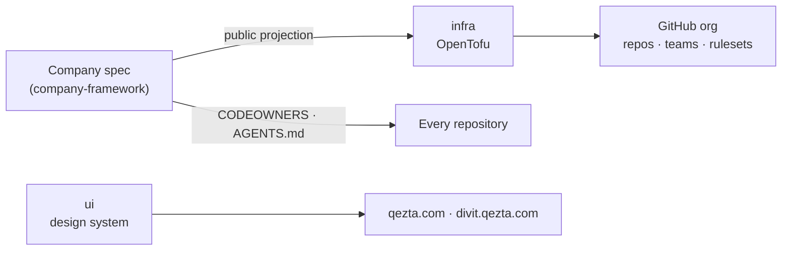

<div align="center">
<a href="https://qezta.com"></a>
<h1>Qezta</h1>
<p><a href="https://qezta.com">qezta.com</a> is being built as the company and product site. In the meantime this org hosts Divit Mittal's portfolio and a handful of shared sub-products.</p>
<p>
<a href="https://qezta.com"></a>
<a href="https://divit.qezta.com"></a>
</p>

</div>

## Try it from your terminal

```sh
ssh qezta@qezta.com   # the Qezta org landing
ssh divit@qezta.com   # Divit's portfolio, as a TUI
```

No shell is ever granted: it's a sandboxed [Bubble Tea](https://github.com/charmbracelet/bubbletea) app served over SSH by [`ssh`](https://github.com/Qezta/ssh).

## Projects

| Project | What it is | Stack |
| --- | --- | --- |
| [**divit**](https://github.com/Qezta/divit) | [divit.qezta.com](https://divit.qezta.com): portfolio with a Gemini-powered RAG chatbot and an in-browser terminal | SvelteKit · TypeScript |
| [**site**](https://github.com/Qezta/site) | [qezta.com](https://qezta.com): the Qezta marketing site (under development) | SvelteKit · TypeScript |
| [**ui**](https://github.com/Qezta/ui) | Shared Svelte component library and design system for every Qezta front end | Svelte · SCSS |
| [**ssh**](https://github.com/Qezta/ssh) | The SSH terminal portfolio above | Go · wish · Bubble Tea |
| [**infra**](https://github.com/Qezta/infra) | Everything in this org as code: repositories, teams, rulesets, DNS | Nix · Terranix · OpenTofu |
| [**company-framework**](https://github.com/Qezta/company-framework) | Describe a company in typed Nix; export Backstage, SCIM, CODEOWNERS, OPA, OpenSLO, AGENTS.md and more | Nix · OPA · Python (MCP) |

## How we build



- **Reproducible by default.** Every repo is a Nix flake with a dev shell, formatters, and pre-commit hooks; `nix develop` is the whole setup.
- **Infrastructure as code.** The repos in this org, their teams and protections, and our DNS are declared in [`infra`](https://github.com/Qezta/infra), not clicked together.
- **The company as code.** Roles, ownership, policies and processes are typed data, built with [`company-framework`](https://github.com/Qezta/company-framework).
- **One design system.** The sites share [`ui`](https://github.com/Qezta/ui), so they look and behave the same.

## Get in touch

For general enquiries, email [hello@qezta.com](mailto:hello@qezta.com)
(`hi@qezta.com` is an alias). Contact Divit at
[divit@qezta.com](mailto:divit@qezta.com).

- Security reports: [security@qezta.com](mailto:security@qezta.com)
- Privacy requests: [privacy@qezta.com](mailto:privacy@qezta.com)
- Legal notices: [legal@qezta.com](mailto:legal@qezta.com)

You can also open an issue on the relevant repository.
